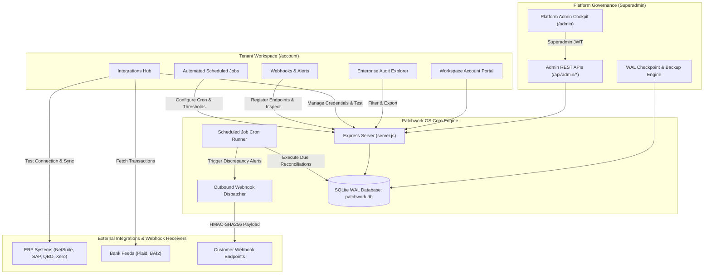
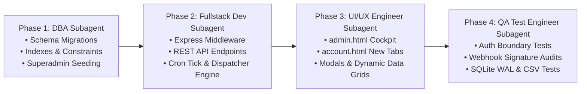

# Patchwork OS — Enterprise Features Expansion Specification

**Document Version:** 1.0.0 (Production Architecture)  
**Author:** Product Management  
**Target Audience:** Engineering Subagents (`dba`, `fullstack-developer`, `ui-ux-engineer`, `qa-test-engineer`), Technical Leadership  
**Status:** Implementation Ready  

---

## 1. Executive Summary & Architectural Vision

Patchwork OS has achieved production-grade multi-tenancy, per-seat licensing, self-service billing management, trial lifecycles, and metered quota controls (detailed in [`SPEC.md`](file:///c:/Users/omu/projects/patchworkos-site/SPEC.md) and [`SAAS_DB_PLAN.md`](file:///c:/Users/omu/projects/patchworkos-site/SAAS_DB_PLAN.md)). 

To scale from a multi-tenant reconciliation tool into an enterprise B2B platform, this specification defines the architecture, data models, API contracts, and user experiences for six (6) core expansion modules:

1. **Platform Admin Dashboard (`/admin`, `admin.html`):** Centralized governance cockpit for platform operators to monitor MRR, active seats, consumption velocity, manage tenant subscriptions, triage support tickets, and inspect system-wide webhooks.
2. **Enterprise Audit Log Explorer (in `account.html`):** SOC2/ISO27001-compliant audit interface with full-text search, multi-vector filtering, JSON metadata inspection, and RFC 4180 CSV export.
3. **Outbound Webhook Dispatcher:** High-reliability webhook dispatcher with HMAC-SHA256 signature verification, replay protection, delivery logging, and automatic retry queues.
4. **Pre-built Connector Integrations Hub:** Turnkey credential management and test runners for NetSuite SuiteTalk, SAP S/4HANA, QuickBooks Online, Xero, and Plaid.
5. **Scheduled Automated Reconciliation Jobs:** Recurring ledger reconciliation cron engine with status reporting and configurable discrepancy threshold alerts.
6. **Database Backup & Disaster Recovery Utility:** Point-in-time recovery utility featuring safe SQLite WAL truncation, online lock-free database snapshots, and secure administrative snapshot downloads.

---

## 2. High-Level Architecture & Workflow



---

## 3. Module 1: Platform Admin Dashboard (`/admin`, `admin.html`)

### 3.1 User Stories
* **US-ADM-01 (Executive KPI Monitoring):** As a platform executive, I want a real-time dashboard displaying active organizations, paid MRR, seat allocations, consumption velocity, and pending support requests so that I can make informed commercial decisions.
* **US-ADM-02 (Tenant Governance & Subscription Overrides):** As a customer success director, I want the ability to inspect any customer workspace, upgrade/downgrade their tier, extend their trial period, adjust seat pools, or suspend delinquent accounts.
* **US-ADM-03 (Support & Inquiry Triage):** As an engineering support lead, I want to review incoming support tickets, demo inquiries, and contact submissions in one unified queue, updating assignees and resolution statuses.
* **US-ADM-04 (Global Webhook Diagnostic Inspector):** As a platform operations engineer, I want to inspect all inbound payment webhooks and outbound customer webhooks across all tenants to troubleshoot delivery failures and replay failed events.

### 3.2 Functional Requirements & Business Rules
1. **Superadmin RBAC Guard:**
   - Any request to `/admin` or `/api/admin/*` MUST require an authenticated JWT belonging to a user with `is_superadmin = 1`.
   - Regular workspace owners, admins, or members attempting access MUST receive HTTP `403 Forbidden` with `{ error: 'Superadmin privileges required.', code: 'FORBIDDEN_SUPERADMIN' }`.
   - Static route `/admin` serves `admin.html`. Unauthenticated visitors are redirected to `/account` or login prompt.
2. **Platform KPI Metrics Aggregator:**
   - **Monthly Recurring Revenue (MRR):** Sum of active subscriptions base pricing + extra seat billings (e.g. Growth = 50,000 KES, Enterprise = 100,000 KES, Extra Seat = 5,000 KES / 10,000 KES).
   - **Active Organizations:** Count grouped by status (`active`, `trialing`, `trial_expired`, `suspended`, `canceled`).
   - **Total Seats:** Aggregate allocated seats vs occupied active seats across all tenants.
   - **Consumption Velocity:** Monthly reconciliation rows processed, developer API calls dispatched, and active ERP connectors.
   - **Support Queue:** Count of open P1/P2/P3 tickets and unreviewed demo requests.
3. **Tenant & Subscription Management:**
   - Ability to search organizations by name, slug, ID, or owner email.
   - Inline action triggers:
     - Change plan (`developer`, `growth`, `enterprise`).
     - Extend trial (+7, +14, +30 days) resetting `status = 'trialing'` and updating `trial_end`.
     - Seat quota override (`allocated_seats`, `extra_seats`).
     - Workspace suspension toggle (`status = 'suspended' | 'active'`).
     - Metered overage toggle and budget cap adjustment (`overage_enabled`, `overage_budget_cap_cents`).
4. **User Directory & Impersonation Token:**
   - Searchable directory of all platform users.
   - Superadmin promotion/revocation toggle.
   - Administrative password reset trigger.
5. **Support & Inbound Requests Operations:**
   - Unified interface managing `tickets`, `contact_inquiries`, and `demo_requests`.
   - Update ticket status (`INVESTIGATING`, `IN PROGRESS`, `ESCALATED`, `RESOLVED`, `CLOSED`) and assignees.
   - Update demo request status (`PENDING_REVIEW`, `CONTACTED`, `SCHEDULED`, `QUALIFIED`, `CLOSED`).
6. **Administrative Audit Trail:**
   - Every administrative mutation (trial extension, tier override, suspension, password reset) MUST be persisted in `admin_audit_logs`.

### 3.3 REST API Contracts

#### `GET /api/admin/metrics`
* **Auth:** Bearer JWT (`is_superadmin = 1`)
* **Response (200 OK):**
```json
{
  "kpis": {
    "mrrCents": 3450000,
    "currency": "KES",
    "totalOrgs": 18,
    "activeSubscriptions": 12,
    "trialingSubscriptions": 4,
    "expiredTrials": 2,
    "totalAllocatedSeats": 85,
    "totalActiveSeats": 62,
    "totalRowsProcessedThisMonth": 4820150,
    "openTicketsCount": 5,
    "pendingDemoRequestsCount": 3
  },
  "tierDistribution": [
    { "planId": "developer", "count": 2 },
    { "planId": "growth", "count": 10 },
    { "planId": "enterprise", "count": 6 }
  ],
  "recentEvents": [
    { "id": "ev_01", "action": "trial_extended", "orgName": "Acme Corp", "adminEmail": "admin@patchworkos.com", "timestamp": "2026-10-14T20:15:00Z" }
  ]
}
```

#### `GET /api/admin/organizations`
* **Auth:** Bearer JWT (`is_superadmin = 1`)
* **Query Parameters:** `search` (string), `status` (string), `plan` (string), `page` (int, default 1), `limit` (int, default 20)
* **Response (200 OK):**
```json
{
  "organizations": [
    {
      "id": "org_acme_corp",
      "name": "Acme Global Corp",
      "slug": "acme-global",
      "ownerEmail": "alex@acme.com",
      "ownerName": "Alex Morgan",
      "status": "active",
      "planId": "growth",
      "planName": "Growth Tier",
      "subscriptionStatus": "active",
      "trialEnd": null,
      "allocatedSeats": 5,
      "activeSeatCount": 3,
      "overageEnabled": true,
      "overageBudgetCapCents": 10000,
      "monthlyRows": 842000,
      "createdAt": "2026-09-01T10:00:00Z"
    }
  ],
  "pagination": { "total": 18, "page": 1, "limit": 20, "totalPages": 1 }
}
```

#### `PATCH /api/admin/organizations/:id/subscription`
* **Auth:** Bearer JWT (`is_superadmin = 1`)
* **Request Body:**
```json
{
  "planId": "enterprise",
  "status": "active",
  "extendTrialDays": 14,
  "allocatedSeats": 20,
  "overageEnabled": true,
  "overageBudgetCapCents": 25000
}
```
* **Response (200 OK):**
```json
{
  "success": true,
  "message": "Organization subscription updated by platform administrator.",
  "organization": {
    "id": "org_acme_corp",
    "planId": "enterprise",
    "status": "active",
    "allocatedSeats": 20,
    "trialEnd": "2026-10-28T23:59:59Z"
  }
}
```

#### `PATCH /api/admin/organizations/:id/status`
* **Auth:** Bearer JWT (`is_superadmin = 1`)
* **Request Body:** `{ "status": "suspended", "reason": "Delinquent payment terms" }`
* **Response (200 OK):** `{ "success": true, "orgId": "org_acme_corp", "status": "suspended" }`

#### `GET /api/admin/users`
* **Auth:** Bearer JWT (`is_superadmin = 1`)
* **Query Parameters:** `search`, `page`, `limit`
* **Response (200 OK):**
```json
{
  "users": [
    {
      "id": 1,
      "name": "Super Admin",
      "email": "admin@patchworkos.com",
      "workspace": "Patchwork HQ",
      "role": "Superadministrator",
      "isSuperadmin": true,
      "createdAt": "2026-01-01T00:00:00Z"
    }
  ],
  "pagination": { "total": 45, "page": 1, "limit": 20, "totalPages": 3 }
}
```

#### `PATCH /api/admin/users/:id/superadmin`
* **Auth:** Bearer JWT (`is_superadmin = 1`)
* **Request Body:** `{ "isSuperadmin": true }`
* **Response (200 OK):** `{ "success": true, "userId": 2, "isSuperadmin": true }`

#### `GET /api/admin/webhooks/inspector`
* **Auth:** Bearer JWT (`is_superadmin = 1`)
* **Query Parameters:** `type` (`inbound` | `outbound`), `status` (string), `limit` (int, default 50)
* **Response (200 OK):**
```json
{
  "deliveries": [
    {
      "id": "del_99812",
      "type": "outbound",
      "orgId": "org_acme_corp",
      "eventType": "recon.batch.completed",
      "targetUrl": "https://api.acme.com/webhooks/ledger",
      "responseStatus": 200,
      "attempts": 1,
      "durationMs": 142,
      "deliveredAt": "2026-10-14T22:30:12Z"
    },
    {
      "id": "inb_4412",
      "type": "inbound",
      "provider": "paystack",
      "eventKey": "charge.success:ref_123",
      "eventType": "charge.success",
      "processedAt": "2026-10-14T21:10:00Z"
    }
  ]
}
```

### 3.4 Acceptance Criteria
* [ ] **AC-ADM-1:** Non-superadmin users requesting `/admin` or `/api/admin/*` are blocked with HTTP 403 and cannot access administrative data.
* [ ] **AC-ADM-2:** The `/api/admin/metrics` endpoint computes accurate MRR from active subscription rates and extra seats.
* [ ] **AC-ADM-3:** Extending a trial from the Admin Dashboard updates `trial_end`, restores subscription status to `trialing`, and immediately allows the tenant to resume batch operations.
* [ ] **AC-ADM-4:** Toggling an organization's status to `suspended` immediately causes `requireActiveSubscriptionOrTrial` to reject tenant mutations with HTTP 403 `ORGANIZATION_SUSPENDED`.
* [ ] **AC-ADM-5:** All admin actions generate structured audit entries in `admin_audit_logs`.

---

## 4. Module 2: Enterprise Audit Log Explorer (in `account.html`)

### 4.1 User Stories
* **US-AUD-01 (Compliance Audit Exploration):** As an enterprise security compliance officer, I want to search and filter our organization's complete audit trail by date range, action type, and user email so that we can satisfy SOC2 and ISO27001 evidence requests.
* **US-AUD-02 (Event Detail Inspection):** As an IT administrator, I want to inspect the full JSON metadata for sensitive operations (role changes, seat pool adjustments, API key provisioning) to identify who initiated the change and from what IP address.
* **US-AUD-03 (One-Click CSV Export):** As an external auditor, I want to export filtered audit records to an RFC 4180-compliant CSV file with a single click.

### 4.2 Functional Requirements & Business Rules
1. **Tenant Scoping & Security:**
   - Audit queries are strictly constrained by `req.auth.orgId`. Zero possibility of cross-tenant log leakage.
   - Read access permitted to workspace `owner` and `admin` roles.
2. **Search & Multi-Vector Filtering:**
   - **Search Query:** Matches against `action`, actor email, user name, or metadata substrings.
   - **Date Range:** `startDate` and `endDate` (ISO8601 or YYYY-MM-DD).
   - **Category/Action Filter:**
     - Authentication & Access (`user_login`, `member_invited`, `member_removed`, `member_role_updated`)
     - Subscription & Billing (`plan_changed`, `trial_started`, `seats_adjusted`, `overage_updated`)
     - Developer Platform (`api_key_created`, `api_key_revoked`, `webhook_endpoint_created`)
     - Reconciliation Operations (`recon_batch_executed`, `job_executed`, `discrepancy_alert`)
     - Integrations (`connector_linked`, `connector_synced`)
3. **Data Grid & Pagination:**
   - Displays: Timestamp (formatted local + UTC hover), Actor (Avatar, Name, Email, IP), Action Badge (color-coded by severity/domain), and Metadata Preview.
   - Paginated at 15/30/50 items per page with next/prev pagination controls.
   - Expandable row revealing formatted JSON metadata.
4. **CSV Export Engine:**
   - Generates streaming or buffered CSV with proper quoting and escaping.
   - File naming convention: `Audit_Log_[OrgSlug]_[YYYYMMDD_HHMMSS].csv`.
   - Headers: `Event ID, Timestamp (UTC), Action, Actor Name, Actor Email, IP Address, Metadata Summary`.

### 4.3 REST API Contracts

#### `GET /api/audit`
* **Auth:** Bearer JWT (`owner` or `admin`)
* **Query Parameters:**
  - `search` (string, optional)
  - `action` (string, optional)
  - `category` (string, optional)
  - `startDate` (ISO string, optional)
  - `endDate` (ISO string, optional)
  - `page` (int, default 1)
  - `limit` (int, default 20)
* **Response (200 OK):**
```json
{
  "logs": [
    {
      "id": 1042,
      "orgId": "org_acme_corp",
      "action": "member_role_updated",
      "category": "team",
      "actor": {
        "id": 12,
        "name": "Alex Morgan",
        "email": "alex@acme.com"
      },
      "ipAddress": "197.232.88.4",
      "userAgent": "Mozilla/5.0 ...",
      "metadata": {
        "memberId": "om_442",
        "previousRole": "member",
        "newRole": "admin"
      },
      "createdAt": "2026-10-14T19:42:10Z"
    }
  ],
  "pagination": {
    "total": 142,
    "page": 1,
    "limit": 20,
    "totalPages": 8
  }
}
```

#### `GET /api/audit/export`
* **Auth:** Bearer JWT (`owner` or `admin`)
* **Query Parameters:** `search`, `action`, `startDate`, `endDate`, `format=csv`
* **Response (200 OK):**
  - `Content-Type: text/csv; charset=utf-8`
  - `Content-Disposition: attachment; filename="Audit_Log_acme-global_20261014.csv"`
  - Body:
```csv
Event ID,Timestamp (UTC),Action,Actor Name,Actor Email,IP Address,Metadata
1042,2026-10-14T19:42:10Z,member_role_updated,Alex Morgan,alex@acme.com,197.232.88.4,"{""memberId"":""om_442"",""previousRole"":""member"",""newRole"":""admin""}"
```

### 4.4 Acceptance Criteria
* [ ] **AC-AUD-1:** Filter by date range returns strictly events occurring within `[startDate, endDate]`.
* [ ] **AC-AUD-2:** Non-admin workspace members (`member`, `viewer`) receive HTTP 403 when calling `/api/audit`.
* [ ] **AC-AUD-3:** Full-text search accurately matches metadata JSON fields (e.g. searching a specific invite email or key prefix).
* [ ] **AC-AUD-4:** CSV export downloads cleanly in Excel/Google Sheets with correct UTF-8 encoding and escaped quotes.

---

## 5. Module 3: Outbound Webhook Dispatcher

### 5.1 User Stories
* **US-WH-01 (Real-time Event Integration):** As a lead developer, I want to register a webhook URL to receive real-time notifications whenever reconciliation batches complete or discrepancies are detected.
* **US-WH-02 (Cryptographic Integrity):** As an enterprise security engineer, I want all outgoing webhook requests signed with an HMAC-SHA256 signature and timestamp so that our receiver can verify payload authenticity and prevent replay attacks.
* **US-WH-03 (Delivery Troubleshooting & Resend):** As an integration engineer, I want to review recent delivery attempts, inspect the HTTP response code and response body from our server, and manually trigger a re-dispatch if our server experienced downtime.

### 5.2 Functional Requirements & Business Rules
1. **Webhook Endpoint Management:**
   - Workspace owners/admins can register up to their plan limit (`developer`: 1, `growth`: 5, `enterprise`: 25).
   - Fields: `url` (valid HTTPS URL), `events` (JSON array of subscribed events), `description`.
   - On creation, generate a cryptographic signing secret: `whsec_` + 32-byte hex.
   - Endpoints can be toggled `active` or `paused`.
2. **Supported Event Types:**
   - `recon.batch.completed`: Fired when a reconciliation batch finishes processing.
   - `recon.discrepancy.flagged`: Fired when an automated job detects discrepancies exceeding tolerance.
   - `subscription.updated`: Fired when plan upgrades, downgrades, or seat adjustments occur.
   - `member.invited` / `member.removed`: Team membership changes.
   - `integration.sync.completed`: ERP sync status updates.
   - `job.run.completed`: Scheduled automated reconciliation finished.
3. **Cryptographic HMAC-SHA256 Signature Specification:**
   - Header: `X-Patchwork-Signature: t={timestamp},v1={hmac_sha256_hex}`
   - Compute signature over string: `${timestamp}.${JSON.stringify(payload)}` using endpoint `secret`.
   - Receiver verifies:
     1. Extracts timestamp `t`. Rejects if `Math.abs(Date.now() - t * 1000) > 300000` (5-minute tolerance).
     2. Computes HMAC-SHA256 and validates with timing-safe comparison.
4. **Dispatcher Delivery Engine:**
   - Dispatches asynchronously via `fetch` with a 10-second timeout.
   - Captures HTTP status code, response body (truncated to 1KB), execution duration (`duration_ms`), and timestamp.
   - Logs every attempt in `webhook_deliveries`.
   - Retry policy: Up to 3 automatic retries with exponential backoff (10s, 60s, 300s) on network failure or 5xx responses.

### 5.3 REST API Contracts

#### `GET /api/webhooks`
* **Auth:** Bearer JWT (`owner` or `admin`)
* **Response (200 OK):**
```json
{
  "endpoints": [
    {
      "id": "whe_01h9x",
      "url": "https://api.acme.com/v1/patchwork-events",
      "events": ["recon.batch.completed", "recon.discrepancy.flagged"],
      "status": "active",
      "secretPrefix": "whsec_9a4f...",
      "createdAt": "2026-10-10T14:20:00Z",
      "lastDeliveredAt": "2026-10-14T22:30:12Z",
      "successRate": 98.5
    }
  ]
}
```

#### `POST /api/webhooks`
* **Auth:** Bearer JWT (`owner` or `admin`)
* **Request Body:**
```json
{
  "url": "https://api.acme.com/v1/patchwork-events",
  "events": ["recon.batch.completed", "recon.discrepancy.flagged"],
  "description": "Acme Production General Ledger Webhook"
}
```
* **Response (201 Created):**
```json
{
  "endpoint": {
    "id": "whe_01h9x",
    "url": "https://api.acme.com/v1/patchwork-events",
    "secret": "whsec_7b8a1c9e3f2d4a5b6c7d8e9f0a1b2c3d4e5f6a7b8c9d0e1f2a3b4c5d6e7f8a9b",
    "events": ["recon.batch.completed", "recon.discrepancy.flagged"],
    "status": "active"
  },
  "message": "Webhook endpoint registered. Save the secret key securely; it will not be displayed in full again."
}
```

#### `POST /api/webhooks/:id/test`
* **Auth:** Bearer JWT (`owner` or `admin`)
* **Request Body:** `{}`
* **Response (200 OK):**
```json
{
  "success": true,
  "delivery": {
    "id": "del_10928",
    "responseStatus": 200,
    "durationMs": 95,
    "deliveredAt": "2026-10-14T23:05:00Z",
    "responseSnippet": "{\"received\":true}"
  }
}
```

#### `GET /api/webhooks/:id/deliveries`
* **Auth:** Bearer JWT (`owner` or `admin`)
* **Query Parameters:** `page`, `limit`
* **Response (200 OK):**
```json
{
  "deliveries": [
    {
      "id": "del_10928",
      "eventType": "recon.batch.completed",
      "payload": { "batchId": "bat_44", "rows": 5000, "status": "MATCHED" },
      "responseStatus": 200,
      "responseBody": "{\"ok\":true}",
      "durationMs": 112,
      "attempts": 1,
      "deliveredAt": "2026-10-14T23:00:10Z"
    }
  ]
}
```

#### `POST /api/webhooks/deliveries/:deliveryId/retry`
* **Auth:** Bearer JWT (`owner` or `admin`)
* **Response (200 OK):**
```json
{
  "success": true,
  "message": "Event re-dispatched.",
  "newDeliveryId": "del_10929",
  "responseStatus": 200
}
```

### 5.4 Acceptance Criteria
* [ ] **AC-WH-1:** Every outgoing webhook request includes `X-Patchwork-Signature` matching `t={ts},v1={hmac}` calculated with the endpoint's secret.
* [ ] **AC-WH-2:** Webhook secret is displayed in full only once at creation; subsequent GET requests return only `secretPrefix`.
* [ ] **AC-WH-3:** Delivering an event to an endpoint returning HTTP 500 logs the failure in `webhook_deliveries` and marks status `failed`.
* [ ] **AC-WH-4:** Manual retry button dispatches identical payload and updates delivery status log.

---

## 6. Module 4: Pre-built Connector Integrations Hub

### 6.1 User Stories
* **US-CON-01 (Turnkey ERP Linking):** As a financial controller, I want to connect our NetSuite, SAP, QuickBooks, or Xero instance using standard credentials so that reconciliation data synchronizes automatically.
* **US-CON-02 (Bank Feed Direct Access):** As a treasury manager, I want to configure Plaid sandbox/live credentials to ingest multi-bank transactions directly into Patchwork OS.
* **US-CON-03 (Connection Health & Verification):** As an IT admin, I want to click "Test Connection" to verify that credentials and permissions are valid before enabling automated jobs.

### 6.2 Functional Requirements & Business Rules
1. **Supported Connectors:**
   - **NetSuite (Oracle):** SuiteTalk REST/SOAP; fields: `accountId`, `consumerKey`, `consumerSecret`, `tokenId`, `tokenSecret`.
   - **SAP S/4HANA:** OData Service; fields: `serviceUrl`, `clientId`, `clientSecret`, `companyCode`.
   - **QuickBooks Online (Intuit):** OAuth2; fields: `realmId`, `clientId`, `clientSecret`, `refreshToken`.
   - **Xero:** OAuth2; fields: `tenantId`, `clientId`, `clientSecret`, `refreshToken`.
   - **Plaid:** Bank Feed; fields: `clientId`, `secret`, `environment` (`sandbox`, `development`, `production`).
2. **Credential Security & Storage:**
   - Secrets MUST be stored encrypted at rest or masked in `integrations` table.
   - Credentials returned in GET responses MUST be masked (e.g. `sec_********************abcd`).
   - Tenant quota check: Growth tier allows 2 connectors; Developer starter allows 0; Enterprise unlimited (-1).
3. **Test Connection Engine:**
   - Validates credential format, performs synthetic ping or handshake against the connector test routine, and records connection latency and status (`connected`, `error`, `disconnected`).
4. **Manual & Scheduled Ingestion Sync:**
   - Endpoint `POST /api/integrations/:id/sync` initiates an ingestion run.
   - Logs outcome into `integration_sync_logs`: records rows retrieved, duration, status, and error details.

### 6.3 REST API Contracts

#### `GET /api/integrations`
* **Auth:** Bearer JWT (`owner` or `admin`)
* **Response (200 OK):**
```json
{
  "integrations": [
    {
      "id": "int_netsuite_01",
      "provider": "netsuite",
      "name": "Acme NetSuite OneWorld (US-West)",
      "status": "connected",
      "config": {
        "accountId": "TSTDRV194021",
        "consumerKey": "ns_key_************9a2f",
        "tokenId": "tok_************4411"
      },
      "lastTestedAt": "2026-10-14T20:00:00Z",
      "lastSyncedAt": "2026-10-14T22:00:00Z",
      "recordsSyncedCount": 45120
    },
    {
      "id": "int_plaid_01",
      "provider": "plaid",
      "name": "J.P. Morgan Treasury Feeds",
      "status": "connected",
      "config": {
        "environment": "sandbox",
        "clientId": "plaid_************0192"
      },
      "lastTestedAt": "2026-10-14T21:30:00Z",
      "lastSyncedAt": "2026-10-14T22:30:00Z",
      "recordsSyncedCount": 12890
    }
  ],
  "connectorQuota": { "consumed": 2, "limit": 2, "isUnlimited": false }
}
```

#### `POST /api/integrations`
* **Auth:** Bearer JWT (`owner` or `admin`, requires available connector quota)
* **Request Body:**
```json
{
  "provider": "netsuite",
  "name": "Corporate NetSuite GL",
  "credentials": {
    "accountId": "TSTDRV194021",
    "consumerKey": "9f8e7d6c5b4a3...",
    "consumerSecret": "1a2b3c4d5e6f...",
    "tokenId": "5a6b7c8d9e0f...",
    "tokenSecret": "0f9e8d7c6b5a..."
  }
}
```
* **Response (201 Created):**
```json
{
  "success": true,
  "integration": {
    "id": "int_netsuite_02",
    "provider": "netsuite",
    "name": "Corporate NetSuite GL",
    "status": "connected"
  }
}
```

#### `POST /api/integrations/:id/test`
* **Auth:** Bearer JWT (`owner` or `admin`)
* **Response (200 OK):**
```json
{
  "success": true,
  "status": "connected",
  "latencyMs": 145,
  "message": "Handshake verified with NetSuite SuiteTalk REST API v2026.1."
}
```

#### `POST /api/integrations/:id/sync`
* **Auth:** Bearer JWT (`owner` or `admin`, requires active subscription or trial)
* **Response (200 OK):**
```json
{
  "success": true,
  "syncId": "sync_9941",
  "recordsIngested": 1500,
  "durationMs": 420,
  "status": "COMPLETED"
}
```

### 6.4 Acceptance Criteria
* [ ] **AC-CON-1:** Workspaces exceeding their plan connector quota are blocked from creating new integrations with HTTP 403 `CONNECTOR_LIMIT_REACHED`.
* [ ] **AC-CON-2:** Inbound credential secrets are stored securely and never returned in plaintext via GET endpoints.
* [ ] **AC-CON-3:** Test connection executes handshake routine and updates integration status to `connected` or `error`.
* [ ] **AC-CON-4:** Manual sync logs records into `integration_sync_logs` and records row usage in `usage_records`.

---

## 7. Module 5: Scheduled Automated Reconciliation Jobs

### 7.1 User Stories
* **US-JOB-01 (Automated Recurring Reconciliations):** As a finance operations lead, I want to schedule daily or hourly reconciliations between our bank feeds and ERP ledger so that manual CSV uploads are eliminated.
* **US-JOB-02 (Discrepancy Threshold Alerts):** As a CFO, I want the system to flag discrepancy alert states and dispatch webhook notifications whenever unmatched variance exceeds $500 or 1% of total batch value.
* **US-JOB-03 (Job Run History & Audit):** As an auditor, I want a complete execution log showing every scheduled run, duration, row count, matched count, and discrepancy breakdown.

### 7.2 Functional Requirements & Business Rules
1. **Job Scheduling Options:**
   - Presets: `hourly` (every hour at :00), `daily_midnight` (00:00 UTC), `daily_close` (17:00 UTC), `weekly_monday` (Monday 06:00 UTC), or standard 5-part cron syntax (e.g. `0 2 * * *`).
2. **Reconciliation Rules & Sources:**
   - Link to configured integrations (e.g. NetSuite + Plaid).
   - Matching rule presets: `strict_exact` (exact amount, date +/- 1 day, reference match), `tolerance_threshold` (amount within tolerance cents), `fuzzy_counterparty` (fuzzy ledger memo string matching).
3. **Discrepancy Alert Thresholds:**
   - Configuration parameters:
     - `alert_threshold_count`: Flag if unmatched items $> X$.
     - `alert_threshold_amount_cents`: Flag if total unmatched variance $> \$Y$ (or KES $Y$).
   - When a job run completes with discrepancies $> threshold$:
     - Run status marked `discrepancy_alert`.
     - Outbound webhook `recon.discrepancy.flagged` dispatched.
     - Audit log event `recon_discrepancy_alert` recorded.
4. **Execution Engine (Tick Runner):**
   - Background interval timer in `server.js` running every 60 seconds.
   - Evaluates active jobs where `next_run_at <= CURRENT_TIMESTAMP`.
   - Verifies tenant subscription status:
     - If subscription is `trial_expired`, `canceled`, or `suspended`: marks run `skipped_subscription_inactive`.
     - Verifies quota: checks `reconciliation_rows` against plan limit; handles overage if enabled or fails run if unmetered cap exceeded.
   - Records execution results in `scheduled_job_runs` and updates `last_run_at` / `next_run_at`.

### 7.3 REST API Contracts

#### `GET /api/jobs`
* **Auth:** Bearer JWT (`owner` or `admin`)
* **Response (200 OK):**
```json
{
  "jobs": [
    {
      "id": "job_daily_bank_recon",
      "name": "Daily Treasury vs NetSuite GL",
      "schedule": "daily_midnight",
      "cronExpr": "0 0 * * *",
      "sourceIntegrationId": "int_netsuite_01",
      "targetIntegrationId": "int_plaid_01",
      "rulePreset": "strict_exact",
      "discrepancyThresholdCents": 50000,
      "discrepancyThresholdCount": 5,
      "isActive": true,
      "lastRunAt": "2026-10-14T00:00:15Z",
      "nextRunAt": "2026-10-15T00:00:00Z",
      "lastRunStatus": "completed",
      "lastRunMatchedPct": 99.8
    }
  ]
}
```

#### `POST /api/jobs`
* **Auth:** Bearer JWT (`owner` or `admin`)
* **Request Body:**
```json
{
  "name": "Daily Treasury vs NetSuite GL",
  "schedule": "daily_midnight",
  "cronExpr": "0 0 * * *",
  "sourceIntegrationId": "int_netsuite_01",
  "targetIntegrationId": "int_plaid_01",
  "rulePreset": "strict_exact",
  "discrepancyThresholdCents": 50000,
  "discrepancyThresholdCount": 5,
  "isActive": true
}
```
* **Response (201 Created):**
```json
{
  "job": {
    "id": "job_01h9z",
    "name": "Daily Treasury vs NetSuite GL",
    "isActive": true,
    "nextRunAt": "2026-10-15T00:00:00Z"
  }
}
```

#### `POST /api/jobs/:id/run`
* **Auth:** Bearer JWT (`owner` or `admin`)
* **Response (200 OK):**
```json
{
  "success": true,
  "run": {
    "id": "run_8812",
    "jobId": "job_01h9z",
    "status": "completed",
    "rowsProcessed": 2500,
    "matchedCount": 2498,
    "discrepancyCount": 2,
    "discrepancyAmountCents": 1250,
    "durationMs": 310,
    "discrepancyThresholdExceeded": false
  }
}
```

#### `GET /api/jobs/:id/runs`
* **Auth:** Bearer JWT (`owner` or `admin`)
* **Response (200 OK):**
```json
{
  "runs": [
    {
      "id": "run_8812",
      "status": "completed",
      "rowsProcessed": 2500,
      "matchedCount": 2498,
      "discrepancyCount": 2,
      "discrepancyAmountCents": 1250,
      "durationMs": 310,
      "createdAt": "2026-10-14T23:30:00Z"
    }
  ]
}
```

### 7.4 Acceptance Criteria
* [ ] **AC-JOB-1:** Creating a scheduled job computes a valid upcoming `next_run_at` timestamp.
* [ ] **AC-JOB-2:** Background tick runner identifies and processes due jobs automatically.
* [ ] **AC-JOB-3:** When discrepancy variance exceeds `discrepancyThresholdCents` or `discrepancyThresholdCount`, the run status transitions to `discrepancy_alert` and an outbound webhook is fired.
* [ ] **AC-JOB-4:** Expired trial workspaces do not execute scheduled jobs; runs are skipped with logged justification.

---

## 8. Module 6: Database Backup & Disaster Recovery Utility

### 8.1 User Stories
* **US-BCK-01 (Safe WAL Checkpointing):** As a database administrator, I want to force an immediate `wal_checkpoint(TRUNCATE)` so that all write-ahead journal transactions are safely merged into the main SQLite database file without dropping connections.
* **US-BCK-02 (Lock-Free Online Snapshot):** As a platform operator, I want to generate a point-in-time snapshot of the production database while the server is live using lock-free online backup APIs.
* **US-BCK-03 (Secure Downloadable Backups):** As a superadmin, I want to review historical snapshots and download encrypted/compressed snapshots with SHA-256 verification hashes.

### 8.2 Functional Requirements & Business Rules
1. **WAL Checkpoint Engine:**
   - Execute `db.pragma('wal_checkpoint(TRUNCATE)')` via `better-sqlite3`.
   - Returns number of checkpointed WAL frames and remaining pages.
2. **Lock-Free Online Snapshot Engine:**
   - Use `db.backup(destinationFilePath)` native to `better-sqlite3`. This utilizes SQLite's online backup API, ensuring complete transaction safety and zero reader/writer locks.
   - Store snapshots in `./backups/` directory with naming convention:
     `patchwork_backup_YYYYMMDD_HHMMSS_[hash].db`.
   - Compute SHA-256 checksum and file size in bytes.
   - Record snapshot entry in `backup_snapshots`.
3. **Automated Rolling Retention Policy:**
   - Automatically purge snapshots older than 7 days, maintaining a maximum of 14 rolling snapshots.
4. **Administrative Download Security:**
   - Download endpoint `GET /api/admin/backup/download/:id` restricted strictly to verified superadmins (`is_superadmin = 1`).
   - Audit event logged on every backup generation, checkpoint, and download.

### 8.3 REST API Contracts

#### `POST /api/admin/backup/checkpoint`
* **Auth:** Bearer JWT (`is_superadmin = 1`)
* **Response (200 OK):**
```json
{
  "success": true,
  "message": "SQLite WAL checkpoint completed successfully.",
  "checkpointResult": {
    "busy": 0,
    "log": 0,
    "checkpointed": 142
  },
  "walSizeBeforeBytes": 613912,
  "walSizeAfterBytes": 0
}
```

#### `POST /api/admin/backup/create`
* **Auth:** Bearer JWT (`is_superadmin = 1`)
* **Response (201 Created):**
```json
{
  "success": true,
  "snapshot": {
    "id": "bck_20261014_235959",
    "filename": "patchwork_backup_20261014_235959.db",
    "sizeBytes": 245760,
    "checksumSha256": "4a7d3b2e...9f1a",
    "createdAt": "2026-10-14T23:59:59Z"
  }
}
```

#### `GET /api/admin/backup/list`
* **Auth:** Bearer JWT (`is_superadmin = 1`)
* **Response (200 OK):**
```json
{
  "snapshots": [
    {
      "id": "bck_20261014_235959",
      "filename": "patchwork_backup_20261014_235959.db",
      "sizeBytes": 245760,
      "checksumSha256": "4a7d3b2e...9f1a",
      "createdAt": "2026-10-14T23:59:59Z"
    }
  ],
  "liveDatabase": {
    "sizeBytes": 241664,
    "walSizeBytes": 0,
    "journalMode": "wal"
  }
}
```

#### `GET /api/admin/backup/download/:id`
* **Auth:** Bearer JWT (`is_superadmin = 1`)
* **Response (200 OK):**
  - Binary file stream (`application/x-sqlite3`)
  - `Content-Disposition: attachment; filename="patchwork_backup_20261014_235959.db"`

### 8.4 Acceptance Criteria
* [ ] **AC-BCK-1:** Superadmin can trigger `POST /api/admin/backup/checkpoint` and truncate the WAL journal to 0 bytes without dropping active connections.
* [ ] **AC-BCK-2:** `POST /api/admin/backup/create` generates a valid, non-corrupt SQLite file that can be opened independently and verified.
* [ ] **AC-BCK-3:** Non-superadmin requests to download snapshots return HTTP 403.
* [ ] **AC-BCK-4:** SHA-256 hash returned by API matches file checksum byte-for-byte.

---

## 9. Database Schema Enhancements (`db.js` Blueprint)

The following tables and columns must be incorporated into [`db.js`](file:///c:/Users/omu/projects/patchworkos-site/db.js) with backwards compatibility migrations using `addColumnIfMissing`.

```sql
-- 1. Superadmin Flag on Users
-- Column: users.is_superadmin INTEGER DEFAULT 0

-- 2. Platform Admin Audit Trail
CREATE TABLE IF NOT EXISTS admin_audit_logs (
  id INTEGER PRIMARY KEY AUTOINCREMENT,
  admin_user_id INTEGER REFERENCES users(id) ON DELETE SET NULL,
  target_org_id TEXT REFERENCES organizations(id) ON DELETE SET NULL,
  target_user_id INTEGER REFERENCES users(id) ON DELETE SET NULL,
  action TEXT NOT NULL,
  metadata TEXT, -- JSON payload of change
  ip_address TEXT,
  created_at DATETIME DEFAULT CURRENT_TIMESTAMP
);

-- 3. Outbound Webhook Deliveries (expanding existing webhook_endpoints)
CREATE TABLE IF NOT EXISTS webhook_deliveries (
  id TEXT PRIMARY KEY,
  endpoint_id TEXT NOT NULL REFERENCES webhook_endpoints(id) ON DELETE CASCADE,
  org_id TEXT NOT NULL REFERENCES organizations(id) ON DELETE CASCADE,
  event_type TEXT NOT NULL,
  payload TEXT NOT NULL, -- JSON event payload
  response_status INTEGER,
  response_body TEXT,
  duration_ms INTEGER,
  attempts INTEGER DEFAULT 1,
  status TEXT DEFAULT 'success', -- success, failed, retrying
  delivered_at DATETIME DEFAULT CURRENT_TIMESTAMP
);

-- 4. Pre-built Connector Integrations
CREATE TABLE IF NOT EXISTS integrations (
  id TEXT PRIMARY KEY,
  org_id TEXT NOT NULL REFERENCES organizations(id) ON DELETE CASCADE,
  provider TEXT NOT NULL, -- netsuite, sap, quickbooks, xero, plaid
  name TEXT NOT NULL,
  credentials_encrypted TEXT NOT NULL, -- JSON encrypted or masked config
  status TEXT DEFAULT 'disconnected', -- connected, disconnected, error, syncing
  last_tested_at DATETIME,
  last_synced_at DATETIME,
  records_synced_count INTEGER DEFAULT 0,
  created_at DATETIME DEFAULT CURRENT_TIMESTAMP,
  updated_at DATETIME DEFAULT CURRENT_TIMESTAMP
);

CREATE TABLE IF NOT EXISTS integration_sync_logs (
  id TEXT PRIMARY KEY,
  integration_id TEXT NOT NULL REFERENCES integrations(id) ON DELETE CASCADE,
  org_id TEXT NOT NULL REFERENCES organizations(id) ON DELETE CASCADE,
  records_ingested INTEGER DEFAULT 0,
  duration_ms INTEGER,
  status TEXT NOT NULL, -- COMPLETED, FAILED
  error_message TEXT,
  created_at DATETIME DEFAULT CURRENT_TIMESTAMP
);

-- 5. Scheduled Automated Reconciliation Jobs
CREATE TABLE IF NOT EXISTS scheduled_jobs (
  id TEXT PRIMARY KEY,
  org_id TEXT NOT NULL REFERENCES organizations(id) ON DELETE CASCADE,
  name TEXT NOT NULL,
  schedule TEXT NOT NULL, -- hourly, daily_midnight, daily_close, weekly_monday, custom_cron
  cron_expr TEXT,
  source_integration_id TEXT REFERENCES integrations(id) ON DELETE SET NULL,
  target_integration_id TEXT REFERENCES integrations(id) ON DELETE SET NULL,
  rule_preset TEXT DEFAULT 'strict_exact',
  discrepancy_threshold_cents INTEGER DEFAULT 0,
  discrepancy_threshold_count INTEGER DEFAULT 0,
  is_active INTEGER DEFAULT 1,
  last_run_at DATETIME,
  next_run_at DATETIME,
  created_at DATETIME DEFAULT CURRENT_TIMESTAMP,
  updated_at DATETIME DEFAULT CURRENT_TIMESTAMP
);

CREATE TABLE IF NOT EXISTS scheduled_job_runs (
  id TEXT PRIMARY KEY,
  job_id TEXT NOT NULL REFERENCES scheduled_jobs(id) ON DELETE CASCADE,
  org_id TEXT NOT NULL REFERENCES organizations(id) ON DELETE CASCADE,
  status TEXT NOT NULL, -- completed, failed, discrepancy_alert, skipped
  rows_processed INTEGER DEFAULT 0,
  matched_count INTEGER DEFAULT 0,
  discrepancy_count INTEGER DEFAULT 0,
  discrepancy_amount_cents INTEGER DEFAULT 0,
  duration_ms INTEGER,
  error_message TEXT,
  created_at DATETIME DEFAULT CURRENT_TIMESTAMP
);

-- 6. Disaster Recovery & Backup Snapshots Catalog
CREATE TABLE IF NOT EXISTS backup_snapshots (
  id TEXT PRIMARY KEY,
  filename TEXT NOT NULL,
  file_path TEXT NOT NULL,
  size_bytes INTEGER NOT NULL,
  checksum_sha256 TEXT NOT NULL,
  created_by_user_id INTEGER REFERENCES users(id) ON DELETE SET NULL,
  created_at DATETIME DEFAULT CURRENT_TIMESTAMP
);

-- High-Performance Indexes
CREATE INDEX IF NOT EXISTS idx_audit_logs_org_created ON audit_logs(org_id, created_at DESC);
CREATE INDEX IF NOT EXISTS idx_webhook_deliveries_org_created ON webhook_deliveries(org_id, delivered_at DESC);
CREATE INDEX IF NOT EXISTS idx_integrations_org ON integrations(org_id);
CREATE INDEX IF NOT EXISTS idx_scheduled_jobs_next_run ON scheduled_jobs(is_active, next_run_at);
CREATE INDEX IF NOT EXISTS idx_scheduled_job_runs_job ON scheduled_job_runs(job_id, created_at DESC);
```

### Seeding Initial Superadmin
In `db.js`, ensure that if no superadmin exists, the primary seed user or first user is assigned `is_superadmin = 1` or an explicit admin user (`admin@patchworkos.com`) is provisioned with a secure default password hash.

---

## 10. UI/UX Interaction Specifications

### 10.1 Platform Admin Dashboard (`admin.html`)
* **Theme & Visual Language:** Dark Enterprise Aesthetic (`#0b0f19` surface, JetBrains Mono for metrics and IDs, Cyan-400 and Indigo-400 glowing accents).
* **Top Header:** 
  - Platform Logo + `"SUPERADMIN COCKPIT"` badge in rose/amber.
  - Active Session: Superadmin Name, Email, and quick-link to `Back to Customer Portal`.
* **KPI Header Row (4 Cards):**
  1. **Platform MRR:** Large monetary display (e.g. `KES 450,000`), breakdown of base + add-on seats.
  2. **Active Workspaces:** Total tenant count, breakdown of active vs trialing vs suspended.
  3. **Seat Pool Utilization:** Total allocated vs active seats across all tenants with progress ring.
  4. **Platform Consumption:** Total reconciliation rows processed this cycle + API requests.
* **Tabbed Workspace Panels:**
  1. **Organizations & Subscriptions:** Searchable table with columns (Organization, Plan, Seats, Trial/Status, Actions). Quick Actions dropdown: Extend Trial, Override Tier, Adjust Seats, Suspend/Activate.
  2. **Platform Users:** Directory of all users across workspaces. Quick Actions: Toggle Superadmin, Reset Password.
  3. **Support & Demo Inquiries:** Split view of active support tickets (`PW-TKT-...`) with priority chips and demo requests with status updater.
  4. **Global Webhook Inspector:** Filterable log of inbound payment webhooks and outbound customer webhooks with payload modal.
  5. **Disaster Recovery & Backups:** Live DB & WAL size display, "Force WAL Checkpoint" button, "Create Lock-Free Snapshot" button, and downloadable snapshots table.

### 10.2 Customer Portal Enhancements (`account.html`)
The existing sidebar navigation in `account.html` will be expanded with four (4) enterprise tabs:
1. **Tab 6: Enterprise Audit Log Explorer (`#tab-audit`)**
   - Header with Date Range picker (Start Date, End Date), Action filter dropdown, and real-time Search input.
   - Action buttons: "Apply Filters" and "Export CSV".
   - Data grid with clickable rows expanding JSON metadata viewer.
2. **Tab 7: Connectors & Integrations (`#tab-integrations`)**
   - Grid cards for NetSuite, SAP, QuickBooks, Xero, Plaid.
   - Status indicators (`Connected`, `Not Configured`, `Error`).
   - Modal dialog to enter API credentials and click "Test Connection".
   - "Sync Now" button with live progress spinner.
3. **Tab 8: Webhooks & Outbound Dispatcher (`#tab-webhooks`)**
   - List of registered webhook endpoints with status badges.
   - "Register New Endpoint" modal with event subscription checkboxes.
   - Delivery History drawer showing HTTP response codes, latency, and "Resend" button.
4. **Tab 9: Scheduled Reconciliation Jobs (`#tab-jobs`)**
   - Active automated jobs list showing schedule, rule preset, discrepancy threshold, and next run countdown.
   - "New Reconciliation Job" builder modal.
   - "Run Ad-Hoc Now" trigger button and execution history table with matched/discrepancy breakdown.

---

## 11. Engineering Subagent Phased Implementation Roadmap



### Phase 1: Database Administrator (`dba`)
* **Objective:** Apply all schema additions cleanly to [`db.js`](file:///c:/Users/omu/projects/patchworkos-site/db.js) without corrupting existing tenant data.
* **Checklist:**
  - [ ] Add `is_superadmin INTEGER DEFAULT 0` column to `users` table via `addColumnIfMissing`.
  - [ ] Create `admin_audit_logs` table.
  - [ ] Create `webhook_deliveries` table.
  - [ ] Create `integrations` and `integration_sync_logs` tables.
  - [ ] Create `scheduled_jobs` and `scheduled_job_runs` tables.
  - [ ] Create `backup_snapshots` table.
  - [ ] Add indexes on `audit_logs`, `webhook_deliveries`, `integrations`, and `scheduled_jobs`.
  - [ ] Seed default superadmin user (`admin@patchworkos.com` or mark primary user).

### Phase 2: Backend & Fullstack Developer (`fullstack-developer`)
* **Objective:** Implement all REST API routes, middlewares, webhook dispatchers, cron runners, and backup utilities in [`server.js`](file:///c:/Users/omu/projects/patchworkos-site/server.js).
* **Checklist:**
  - [ ] Implement `requireSuperAdmin` middleware.
  - [ ] Implement `/api/admin/metrics`, `/api/admin/organizations`, `/api/admin/subscriptions/:id`, `/api/admin/users`, `/api/admin/webhooks/inspector`.
  - [ ] Implement `/api/audit` multi-vector search and `/api/audit/export` RFC 4180 CSV generator.
  - [ ] Implement `/api/webhooks` CRUD, HMAC-SHA256 signer, and background dispatcher.
  - [ ] Implement `/api/integrations` CRUD, credential masker, test runner, and sync endpoints.
  - [ ] Implement `/api/jobs` CRUD, ad-hoc runner, and 60-second cron scheduler tick loop with threshold alert triggers.
  - [ ] Implement `/api/admin/backup/checkpoint`, `/api/admin/backup/create` (using `better-sqlite3` native `.backup()`), `/api/admin/backup/list`, and `/api/admin/backup/download/:id`.
  - [ ] Configure Express route to serve `/admin` as `admin.html`.

### Phase 3: UI/UX Engineer (`ui-ux-engineer`)
* **Objective:** Build the platform administration dashboard (`admin.html`) and expand the customer portal (`account.html`).
* **Checklist:**
  - [ ] Build `admin.html` with Tailwind CSS, KPI metric cards, organization table with action dropdowns, support triage, webhook inspector, and disaster recovery controls.
  - [ ] Add Tab 6 (Audit Explorer) to `account.html` with date pickers, action filter, search bar, paginated grid, and CSV export button.
  - [ ] Add Tab 7 (Connectors & Integrations) to `account.html` with NetSuite, SAP, QBO, Xero, Plaid cards, credential modal, and test button.
  - [ ] Add Tab 8 (Webhooks & Outbound Dispatcher) to `account.html` with endpoint manager, secret display modal, and delivery logs table.
  - [ ] Add Tab 9 (Scheduled Reconciliation Jobs) to `account.html` with job configuration modal, alert threshold inputs, and run history drawer.
  - [ ] Wire up real fetch requests to all new REST API endpoints.

### Phase 4: Quality Assurance & Verification (`qa-test-engineer`)
* **Objective:** Execute comprehensive automated test scripts and end-to-end verification.
* **Checklist:**
  - [ ] Verify Superadmin Security: Confirm non-superadmin tokens are rejected with HTTP 403 on all `/api/admin/*` endpoints and `/admin`.
  - [ ] Verify Audit Trail: Test date range filtering, search terms, and verify exported CSV matches RFC 4180 standards.
  - [ ] Verify Outbound Webhook Dispatcher: Validate HMAC-SHA256 signature against local test receiver endpoint; verify delivery logs.
  - [ ] Verify Connector Integrations: Test handshake simulation, credential masking, and quota enforcement.
  - [ ] Verify Scheduled Jobs: Confirm cron runner executes due jobs, logs run records, and triggers discrepancy alerts when thresholds are exceeded.
  - [ ] Verify Disaster Recovery: Execute WAL checkpoint (verify WAL size drops), generate snapshot, verify SHA-256 hash, and verify downloaded backup file integrity.

---

## 12. Definition of Done & Sign-off Criteria

1. **Zero Regression:** All existing billing features (trials, proration, overages, per-seat licensing, invoices) verified working.
2. **Deterministic Security:** All tenant endpoints strictly filtered by `org_id`; all platform admin endpoints strictly guarded by `is_superadmin = 1`.
3. **Data Integrity:** Database schema changes applied idempotently via `better-sqlite3` migrations without dropping tables.
4. **Performance:** Audit and log queries execute with indexed lookups under 50ms; lock-free backups complete without blocking concurrent reads/writes.
5. **Specification Compliance:** All acceptance criteria across Modules 1 through 6 pass verification.
