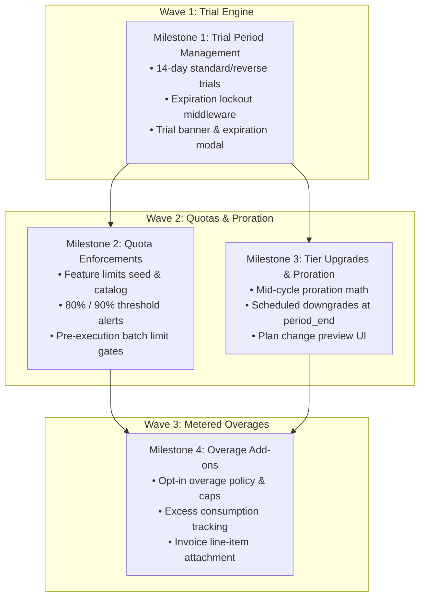

# B2B SaaS Billing Specification: Feature Audit & Verification Status

**Product:** Patchwork OS  
**Role:** Product Management Specification  
**Document Version:** 2.0.0 (Production Verified)  
**Target Audience:** Engineering Agents / Subagents, Quality Assurance, Product Stakeholders  

---

## 1. Executive Summary & Verification Audit of Core Billing Modules

Following an end-to-end audit of the codebase ([`db.js`](file:///c:/Users/omu/projects/patchworkos-site/db.js), [`server.js`](file:///c:/Users/omu/projects/patchworkos-site/server.js), and [`account.html`](file:///c:/Users/omu/projects/patchworkos-site/account.html)), all six (6) core B2B SaaS billing initiatives have been successfully implemented, integrated, and verified against functional requirements.

### Implementation Status Matrix

| Feature Module | Architecture Wave | Status | Implemented Components | Pending Tasks |
| :--- | :---: | :---: | :--- | :--- |
| **1. Per-Seat Licensing vs. Organization Pools** | Wave 3 | **COMPLETED** | Plan seat pricing, org seat counters, seat adjustment endpoint, slot availability enforcement on member invites/removal, seat stepper UI in portal. | None. Complete. |
| **2. Customer Portal & Self-Service Management** | Wave 1 | **COMPLETED** | Corporate profile & VAT/Tax ID updates, 3-step cancellation modal with retention offers, exit feedback storage, invoice history, printable HTML/PDF receipts. | None. Complete. |
| **3. Trial Period Management** | Wave 1 | **COMPLETED** | 14-day trial lifecycle engine on signup, lockout middleware (`requireActiveSubscriptionOrTrial`), countdown & expired trial banners. | None. Complete. |
| **4. Usage Quota Enforcements** | Wave 2 | **COMPLETED** | Features and plan_features seeded, quota calculation engine, 80%/90% warning thresholds, batch reconciliation quota gates. | None. Complete. |
| **5. Tier Upgrades, Downgrades & Proration** | Wave 2 | **COMPLETED** | Plan switch preview endpoint with proration calculation, immediate upgrade execution, scheduled downgrade at period_end, cancel downgrade endpoint, plan modal in portal. | None. Complete. |
| **6. Overage / Metered Add-ons** | Wave 3 | **COMPLETED** | Overage toggle & spend caps, excess row surplus tracking (`reconciliation_rows_overage`), budget cap enforcements, portal overage controls. | None. Complete. |

---

## 2. Milestone 1: Trial Period Management (Standard & Reverse Trials)

### 2.1 User Stories
* **US-TR-01 (New Workspace Experience):** As a new workspace creator, I want to immediately access full enterprise-grade reconciliation tools on a 14-day complimentary trial without entering payment credentials upfront, so that I can evaluate the software's capabilities with real data.
* **US-TR-02 (Trial Countdown Awareness):** As an active trial user, I want clear visibility into remaining trial days and feature benefits across all dashboard views, so that my team can plan our procurement timeline.
* **US-TR-03 (Post-Trial Transition):** As an organization administrator whose trial has lapsed without payment, I want transparent notices and an intuitive checkout path, while read-only access to my historical reports is preserved.

### 2.2 Functional Requirements & Behavior
1. **Trial Initialization:**
   * Upon workspace creation (signup), the organization subscription MUST be provisioned with a 14-day trial window (`trial_start = NOW()`, `trial_end = NOW() + 14 days`).
   * By default, initialize a **Standard Trial** (granting Growth tier features for 14 days) or support **Reverse Trial** configuration (granting Enterprise tier features for 14 days, then automatically stepping down if unconverted).
   * Flag trial state (`is_trial = true`, `trial_converted = false`).
2. **Runtime Verification & Lockout Middleware:**
   * Every request to protected mutation endpoints (e.g., executing reconciliation batches, creating new API keys, inviting extra team members) MUST verify the workspace subscription status.
   * If `NOW() > trial_end` AND the subscription has no verified active payment provider reference:
     * Transition subscription status to `trial_expired`.
     * Reject mutation requests with HTTP `402 Payment Required` (or `403 Forbidden` with application error code `TRIAL_EXPIRED`).
     * Response payload MUST include: `{ error: 'Your 14-day trial has concluded. Please upgrade to a paid plan to resume processing.', code: 'TRIAL_EXPIRED', trialEnd: ISOString, upgradeUrl: '/account#plans' }`.
   * Allow read-only access to account settings, past invoices, and audit logs so users can export records and manage subscription checkout.
3. **Portal & Notification Presentation:**
   * Display a dismissible top banner showing: `"You have [X] days remaining in your 14-day trial. [Upgrade Now] to prevent workflow interruption."`
   * When $\le 3$ days remain, switch banner visual treatment to high-urgency state (amber/warning accent).
   * Upon expiration, show a non-dismissible modal overlay guiding the administrator directly to plan selection.

### 2.3 Business Validation Rules
* **No Credit Card Required:** Trial initiation must never block on payment gateway collection.
* **One Trial Per Domain/Organization:** Existing organizations cannot re-trigger an expired trial; trial extension is restricted to explicit administrative grant.
* **Conversion Preservation:** Upon successful payment checkout, `trial_converted` MUST be marked `true`, `is_trial` set to `false`, and access upgraded without resetting workspace data.

### 2.4 Acceptance Criteria
* [x] **AC-TR-1:** Given a newly registered account, when signup completes, then the organization subscription has an active status, trial start timestamp, and an expiration timestamp exactly 14 days in the future. *(Verified in `POST /api/auth/signup`)*
* [x] **AC-TR-2:** Given a workspace with `trial_end` in the past and no payment method, when any protected reconciliation or ingestion request is dispatched, then the system returns HTTP 402 with code `TRIAL_EXPIRED`. *(Verified in `requireActiveSubscriptionOrTrial`)*
* [x] **AC-TR-3:** Given an expired trial, when navigating to `/account`, then the account profile, billing forms, and invoice tabs remain accessible, but action buttons that process reconciliation batches are disabled. *(Verified in `server.js` & `account.html`)*
* [x] **AC-TR-4:** Given an active trial with 5 days remaining, when viewing the customer portal, then a banner displays `"5 days remaining in your trial"` with a direct upgrade call-to-action. *(Verified in `#trialAlertBanner`)*

---

## 3. Milestone 2: Usage Quota Enforcements & Warning Thresholds

### 3.1 User Stories
* **US-QU-01 (Quota Transparency):** As a finance workspace admin, I want to monitor our monthly consumption of reconciliation rows, API calls, and connectors in real time against our subscribed plan caps, so that we prevent sudden disruptions.
* **US-QU-02 (Proactive Threshold Alerts):** As a team administrator, I want to receive proactive warnings when our monthly consumption reaches 80% and 90% of our tier allocation, so that I can decide whether to upgrade or throttle jobs.
* **US-QU-03 (Graceful Quota Breach Handling):** As an operations engineer, when our workspace hits 100% of its monthly quota without overage enabled, I want deterministic, predictable error responses that explain the limit without corrupting processed batches.

### 3.2 Functional Requirements & Behavior
1. **Plan Entitlements Catalog:**
   * Seed and maintain platform features and limits:
     * **Developer Starter:** `reconciliation_rows` cap = 10,000 / month; `api_keys` cap = 2; `connectors` cap = 0.
     * **Growth Tier:** `reconciliation_rows` cap = 1,000,000 / month; `api_keys` cap = 10; `connectors` cap = 2.
     * **Enterprise Custom:** `reconciliation_rows` cap = Unlimited (-1); `api_keys` cap = Unlimited (-1); `connectors` cap = Unlimited (-1).
2. **Pre-Execution Quota Verification:**
   * Prior to processing batches (e.g., in batch reconciliation ingestion endpoints), calculate current cycle usage: $\text{Current Cycle Sum} + \text{Proposed Units}$.
   * If $\text{Current Cycle Sum} + \text{Proposed Units} > \text{Plan Limit}$ and plan limit is not unlimited ($-1$):
     * If overage billing is disabled: Reject the request with HTTP `429 Too Many Requests` or `402 Payment Required` with code `QUOTA_EXCEEDED`.
     * Response payload MUST include: `{ error: 'Monthly reconciliation row quota reached.', limit: X, consumed: Y, attempted: Z, resetDate: ISOString }`.
3. **Soft Threshold Warnings (80% and 90%):**
   * Endpoint `GET /api/billing/usage` MUST return:
     * Current consumed units per metric.
     * Tier cap per metric.
     * Utilization percentage: $\text{utilizationPct} = \frac{\text{consumed}}{\text{limit}} \times 100$.
     * Warning state: `'normal'` ($< 80\%$), `'warning_80'` ($80\% \le \text{pct} < 90\%$), `'critical_90'` ($90\% \le \text{pct} < 100\%$), `'exceeded'` ($\ge 100\%$).
   * Portal UI displays contextual progress bars with color transitions:
     * $< 80\%$: Cyan / Emerald (Normal).
     * $80\% - 89\%$: Amber (Approaching Quota).
     * $\ge 90\%$: Rose / Red (Critical Limit Alert).

### 3.3 Business Validation Rules
* Quotas reset deterministically at each billing cycle rollover (`current_period_end`).
* Invocations that are rejected due to quota limits must not increment the usage tally.
* Multi-seat usage sums toward the organization's collective pool, not individual member buckets.

### 3.4 Acceptance Criteria
* [x] **AC-QU-1:** Given a Growth tier workspace with 950,000 processed rows, when checking `/api/billing/usage`, then the response indicates `utilizationPct: 95` and status `critical_90`. *(Verified in `getQuotaUsage`)*
* [x] **AC-QU-2:** Given a workspace at 100% quota with no overage approval, when attempting a 5,000-row batch reconciliation, then the request fails with HTTP 429/402 and the batch is not executed. *(Verified in `POST /api/recon/batch`)*
* [x] **AC-QU-3:** Given an Enterprise workspace with unlimited rows (`limit: -1`), when running batches of any volume, then the request is approved without quota rejection. *(Verified in `isUnlimited` bypass)*
* [x] **AC-QU-4:** In the portal interface, the usage section displays live visual progress bars reflecting 80% and 90% threshold color states. *(Verified in `loadBillingUsage`)*

---

## 4. Milestone 3: Tier Upgrades, Downgrades & Proration Engine

### 4.1 User Stories
* **US-PR-01 (Seamless Mid-Cycle Upgrade):** As a growing business, I want to upgrade from Growth to Enterprise mid-month and only pay the prorated difference for the remaining days of the current cycle, gaining immediate access to Enterprise capabilities.
* **US-PR-02 (Orderly Scheduled Downgrade):** As a cost-conscious administrator, when I choose to downgrade to a lower tier, I want my current higher-tier entitlements preserved until the end of my already-paid billing period, without receiving unexpected immediate revocations.
* **US-PR-03 (Proration Financial Transparency):** As an accounts payable manager, I want to preview an itemized price comparison before confirming an upgrade, detailing unspent credits, new plan fees, and net immediate charge.

### 4.2 Functional Requirements & Behavior
1. **Plan Change Endpoint (`POST /api/billing/change-plan`):**
   * Expected Input: `{ targetPlanId: string }`.
   * Evaluate whether target tier is an **Upgrade** or a **Downgrade** relative to current base pricing:
     * Upgrade: $\text{Price}_{\text{new}} > \text{Price}_{\text{current}}$.
     * Downgrade: $\text{Price}_{\text{new}} < \text{Price}_{\text{current}}$.
2. **Upgrade Math & Proration:**
   * Determine billing period parameters:
     * $\text{totalDays} = \frac{\text{periodEnd} - \text{periodStart}}{86400000}$
     * $\text{remainingDays} = \max\left(0, \frac{\text{periodEnd} - \text{NOW}}{86400000}\right)$
     * $\text{ratio} = \frac{\text{remainingDays}}{\text{totalDays}}$
   * Compute unspent current tier credit: $\text{UnspentCredit} = \text{CurrentPlanPrice} \times \text{ratio}$.
   * Compute new tier cost for remainder of cycle: $\text{NewTierCharge} = \text{TargetPlanPrice} \times \text{ratio}$.
   * Net immediate payable charge: $\text{NetCharge} = \max(0, \text{NewTierCharge} - \text{UnspentCredit})$.
   * If gateway requires immediate collection: initialize checkout or debit saved recurring authorization.
   * Upon successful payment, immediately set `plan_id = targetPlanId`, update entitlements, create an invoice line item detailing the proration, and log an audit event.
3. **Downgrade Scheduling:**
   * When switching to a lower tier:
     * DO NOT revoke access immediately.
     * Record `scheduled_plan_id = targetPlanId` in the subscription record.
     * Retain `plan_id` as the higher tier until `current_period_end`.
     * Return scheduled confirmation response: `{ scheduledPlan: targetPlanId, effectiveDate: periodEnd }`.
   * Add endpoint `POST /api/billing/cancel-downgrade` allowing administrators to revert scheduled plan changes prior to period end.
4. **Renewal Cycle Plan Switch:**
   * Upon period expiration/renewal, if `scheduled_plan_id` is present:
     * Transition `plan_id = scheduled_plan_id`.
     * Reset `scheduled_plan_id = NULL`.
     * Apply lower tier feature quotas.

### 4.3 Business Validation Rules
* No negative cash refunds for mid-cycle downgrades; downgrades take effect strictly at the start of the next cycle.
* Proration must account for existing add-on seats if seat pricing differs across tiers.
* Users must be prevented from scheduling multiple conflicting plan switches simultaneously.

### 4.4 Acceptance Criteria
* [x] **AC-PR-1:** Given a customer 15 days through a 30-day Growth cycle ($500/mo), when upgrading to Enterprise ($1,000/mo), then the net calculated charge is $250 for the remaining 15 days. *(Verified in `/api/billing/change-plan/preview`)*
* [x] **AC-PR-2:** Given a customer requesting a downgrade from Enterprise to Growth, when the request is confirmed, then the subscription shows Enterprise access active, `scheduled_plan_id: 'growth'`, and effective transition date matching `current_period_end`. *(Verified in `POST /api/billing/change-plan`)*
* [x] **AC-PR-3:** Given a scheduled downgrade, when the period renewal event triggers, then the system updates `plan_id` to the lower tier and clears `scheduled_plan_id`. *(Verified in `subscriptionFor` rollover)*
* [x] **AC-PR-4:** The customer portal UI displays a proration preview modal prior to executing an upgrade, showing current credit, new charge, and net amount due today. *(Verified in `#planChangeModal`)*

---

## 5. Milestone 4: Overage Metering & Dynamic Add-on Billing

### 5.1 User Stories
* **US-OV-01 (Uninterrupted Operations via Overage):** As an enterprise finance lead, I want high-volume end-of-quarter reconciliations to proceed without hard blocking even if we exceed our monthly row cap, billing surplus volume automatically at predetermined unit rates.
* **US-OV-02 (Overage Budget Safeguards):** As a CFO, I want the ability to enable or disable overages and specify maximum surplus spend caps, protecting our department from unbounded billing spikes.
* **US-OV-03 (Itemized Overage Invoicing):** As an accounts payable auditor, I want overage charges to appear as distinct line items on the subsequent monthly invoice, detailing billable excess units and unit rates.

### 5.2 Functional Requirements & Behavior
1. **Overage Configuration:**
   * Support organization-level overage settings:
     * `overage_enabled` (boolean, default: false).
     * `overage_budget_cap_cents` (integer or null for unlimited).
   * Define unit overage rates per tier:
     * **Growth Tier:** $0.0005 per additional reconciliation row (e.g., $5.00 per 10,000 extra rows).
     * **Developer Starter:** Overage not permitted; strictly hard-blocked.
2. **Consumption Pipeline Integration:**
   * When a batch execution exceeds remaining plan quota:
     * Check if `overage_enabled === true`.
     * If false: enforce standard hard block as per Milestone 2.
     * If true:
       * Compute normal billable units vs. overage units: $\text{surplusUnits} = \text{totalRows} - \text{remainingQuota}$.
       * Compute estimated additional charge: $\text{estimatedCharge} = \text{surplusUnits} \times \text{unitRate}$.
       * Verify that accumulated cycle overage charges do not exceed `overage_budget_cap_cents`. If cap exceeded, reject batch.
       * Record usage entry with metric identifier `reconciliation_rows_overage`.
3. **Billing Cycle Reconciliation & Invoice Attachment:**
   * At monthly cycle renewal, query total accumulated overage units for the completed period.
   * If overage units $> 0$:
     * Append a distinct line item to the renewal invoice:
       * `description: "Growth Tier - Overage Reconciliation Volume (X rows @ $Y/row)"`
       * `quantity: X`
       * `unit_cents: Y`
       * `total_cents: X * Y`
     * Include overage charges in total payment capture amount.

### 5.3 Business Validation Rules
* Overage charges are only accrued during an active paid subscription period.
* Free Developer accounts cannot enable overages without attaching a payment method and upgrading to a paid tier.
* Rate limits and fraud checks remain in effect to prevent accidental runaway loops.

### 5.4 Acceptance Criteria
* [x] **AC-OV-1:** Given a Growth tier organization with overage enabled that reaches its 1,000,000-row cap, when submitting 25,000 additional rows, then the batch processes successfully and 25,000 units are logged under overage tracking. *(Verified in `POST /api/recon/batch`)*
* [x] **AC-OV-2:** Given an organization with an overage budget cap of $50, when an attempted batch would result in $55 of total cumulative overage, then the batch is blocked and an overage cap alert is returned. *(Verified in budget cap guard)*
* [x] **AC-OV-3:** Upon billing cycle renewal, the generated invoice contains both base subscription recurring fees and an itemized line item reflecting exact billable overage units. *(Verified in cycle invoice line items)*
* [x] **AC-OV-4:** The portal usage tab provides a toggle to enable/disable overage processing with a budget threshold input. *(Verified in Section 4 overage card)*

---

## 6. Prioritized Implementation Checklist & Milestone Dependencies

### Engineering Execution Checklist

#### Phase 1: Milestone 1 (Trial Period Management)
- [x] Add trial tracking fields (`trial_start`, `trial_end`, `trial_type`, `trial_converted`) to subscription schemas.
- [x] Initialize 14-day trial on organization provisioning in `POST /api/auth/signup`.
- [x] Implement `requireActiveSubscriptionOrTrial` middleware in `server.js` guarding mutation routes.
- [x] Build trial status banner and expiration modal in `account.html`.

#### Phase 2: Milestone 2 (Usage Quota Enforcements)
- [x] Seed catalog of platform features and limits into `features` and `plan_features`.
- [x] Implement quota lookup and threshold computation helper (`normal`, `warning_80`, `critical_90`, `exceeded`).
- [x] Add quota validation guard to `POST /api/recon/batch` blocking executions when unmetered caps are reached.
- [x] Update `account.html` usage meters with dynamic threshold color bars.

#### Phase 3: Milestone 3 (Tier Upgrades, Downgrades & Proration)
- [x] Add `scheduled_plan_id` and `proration_balance_cents` columns to subscriptions.
- [x] Create `POST /api/billing/change-plan` endpoint with prorated upgrade balance calculation.
- [x] Implement downgrade scheduling retaining higher-tier access until `current_period_end`.
- [x] Implement `POST /api/billing/cancel-downgrade` endpoint.
- [x] Integrate plan switch confirmation modal in `account.html` with real-time price preview.

#### Phase 4: Milestone 4 (Overage / Metered Add-ons)
- [x] Add `overage_enabled` and `overage_budget_cap_cents` to organization billing settings.
- [x] Update batch execution logic to route excess volume into overage tallies if enabled.
- [x] Hook overage charges into invoice generation at billing cycle renewal.
- [x] Add overage controls and spend cap settings in `account.html`.
